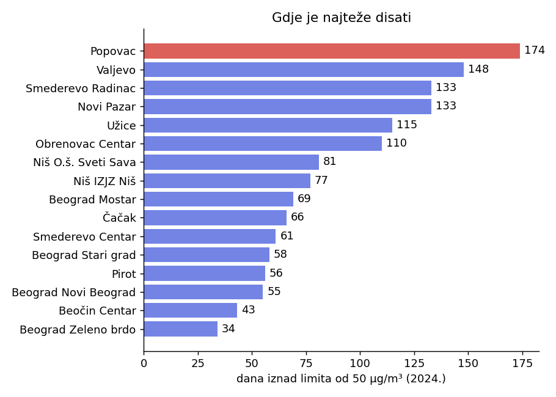
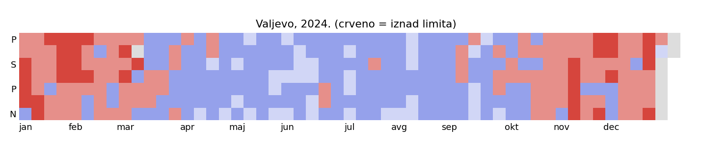
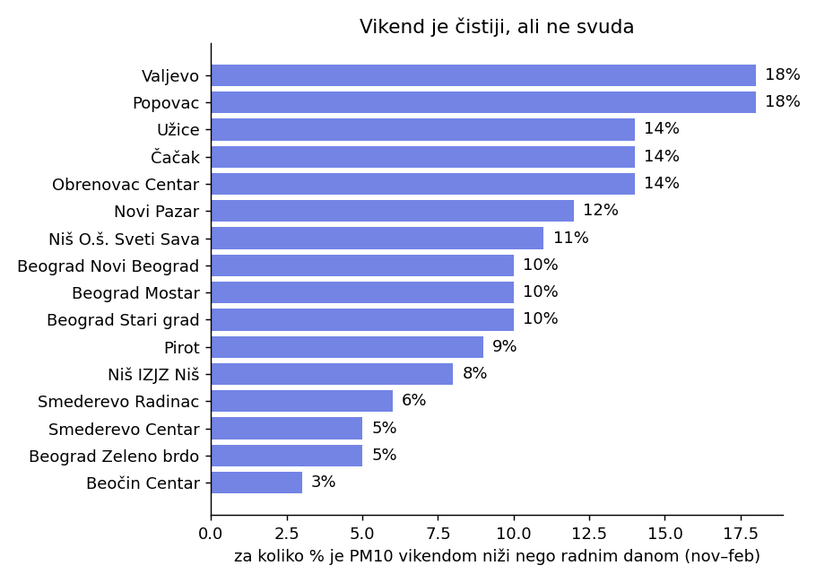
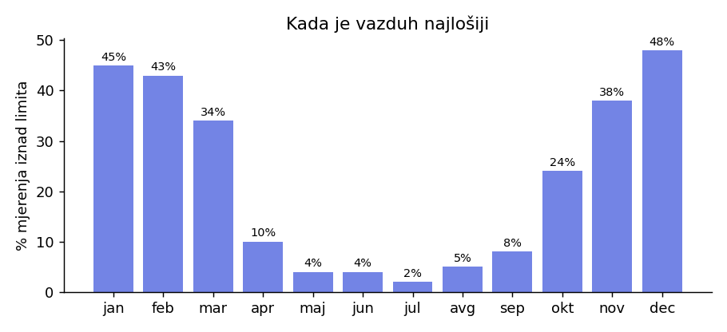
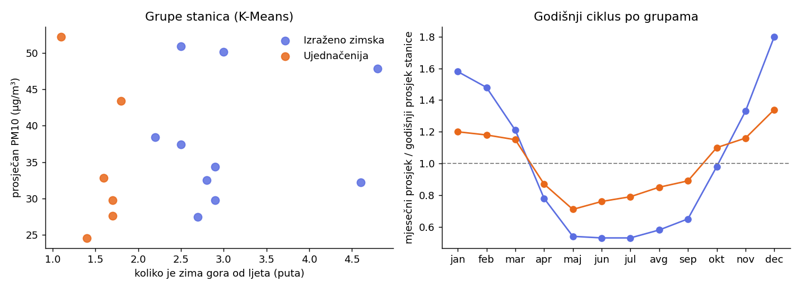

# Kako Srbija diše: analiza i grupisanje mjernih stanica PM10

Istraživanje javnih podataka o kvalitetu vazduha u Srbiji: koliko dana pojedine stanice prelaze limit, kako se zagađenje mijenja kroz godinu i sedmicu, i koje stanice "dišu" na isti način (K-Means grupisanje).

Autor: Matea Masleša

**Interaktivna stranica:** [DOPUNI: link, nakon što podijeliš stranicu]

## Podaci

- Dnevni prosjeci PM10 (µg/m³) sa **16 stanica državne mreže**, 2022–2024. Izvor: Agencija za zaštitu životne sredine (SEPA), portal otvorenih podataka data.gov.rs.
- Fajl `data/pm10_dnevno_2022_2024.csv` je spojen iz godišnjih fajlova (postupak je opisan u repozitoriju *valjevo-air-quality-prediction*, skripta `01_prepare_data.py`). Provjerite licencu SEPA skupova na portalu prije ponovne upotrebe.
- Dnevni limit korišćen u analizi: **50 µg/m³**.

## Šta je rađeno

1. **Dani iznad limita** po stanici i godini (`src/01_analysis.py`).
2. **Vikend naspram radnog dana** u grijnoj sezoni (novembar–februar).
3. **Sezonalnost:** udio mjerenja iznad limita po mjesecima.
4. **Grupisanje stanica** (`src/02_kmeans_stations.py`): K-Means sa dvije grupe nad 15 obilježja po stanici (12 relativnih mjesečnih prosjeka, odnos zime i ljeta, vikend razlika, logaritam prosječnog nivoa), uz standardizaciju. Oznake grupa se poravnavaju tako da je grupa A ona sa većim omjerom zime i ljeta.
5. **Provjera pouzdanosti grupa:** silhouette, poređenje sa hijerarhijskim (Ward) grupisanjem i stabilnost grupa kad se svaka godina grupiše zasebno (adjusted Rand index).

## Rezultati

**Dani iznad limita, 2024.**



- Najviše: **Popovac, 174 dana**; najmanje: **Beograd Zeleno brdo, 34 dana**, odnosno pet puta manje.

**Jedna stanica, jedna godina**



**Vikend je čistiji, ali ne svuda**



- U zimskim mjesecima je PM10 vikendom niži za **18%** u Valjevu i Popovcu, a samo **3%** na Beočinu. Razlog se iz ovih podataka ne može utvrditi.

**Sezonalnost**



- Iznad limita je bilo oko **48%** mjerenja u decembru i **45%** u januaru, a samo **2 do 5%** od maja do avgusta.

**Grupe stanica**



| Grupa | Broj stanica | Omjer zima/ljeto (prosjek) |
|---|---|---|
| Izraženo zimska | 10 (Novi Pazar, Niš ×2, Valjevo, Pirot, Smederevo Centar, Čačak, Beograd Mostar, Užice, Obrenovac) | oko 3 |
| Ujednačenija | 6 (Smederevo Radinac, Beograd ×3, Beočin, Popovac) | oko 1,6 |

Svi brojevi su u `results/`.

## Koliko je grupisanje pouzdano

| Mjera | Vrijednost | Značenje |
|---|---|---|
| Silhouette | 0,32 | slabo do umjereno razdvajanje grupa |
| Slaganje sa Ward grupisanjem (ARI) | 1,00 | drugi metod daje isti raspored |
| Slaganje rasporeda među godinama (ARI, prosjek) | 0,30 | grupe se djelimično mijenjaju iz godine u godinu |

Zaključak je da je podjela upotrebljiva, ali da je granica između grupa **meka**. Tabela `results/klasteri_stanice.csv` ima i kolonu `godina_u_grupi` (u koliko od 3 godine je stanica u istoj grupi kao u ukupnom rješenju); najnestalnija je stanica Obrenovac Centar.

## Ograničenja

- Samo **16 stanica**, što je malo za klasterovanje, pa je rezultat istraživački.
- Dnevni prosjeci kriju kratke vrhove unutar dana.
- Za neke dane mjerenja nedostaju. Mjesec sa manje od 15 dana mjerenja ne ulazi u profil stanice, a rijetke rupe se popunjavaju susjednim mjesecima.
- Iz podataka se ne vidi **zašto** neka stanica ima određeni obrazac (grijanje, industrija, položaj), samo kako se ponaša.
- Jedan dan iznad limita nije isto što i prekoračenje godišnje dozvoljenog broja dana.
- Ovo je analiza javnih podataka, a ne zdravstvena procjena.

## Struktura i pokretanje

```
data/      pm10_dnevno_2022_2024.csv
src/       01_analysis.py, 02_kmeans_stations.py, 03_figures.py
results/   tabele (csv) i grafici (png)
```

```bash
pip install -r requirements.txt
python src/01_analysis.py
python src/02_kmeans_stations.py
python src/03_figures.py
```

Skripte se pokreću redom iz korijena repozitorija.
